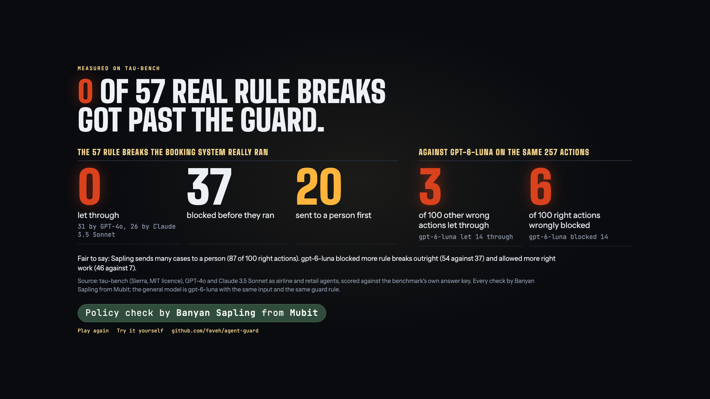

# Agent Guard

**Banyan Sapling from Mubit checks every AI support-agent action against the written policy before it runs.**
The agent wants to cancel a booking, issue a refund or swap an order. Before that happens, Sapling reads the policy and the facts from the real records, and the guard blocks it, allows it, or sends it to a person. It never reads the chat, so a customer cannot talk it round.

- **Live demo:** https://agent-guard-beryl.vercel.app/
- **Auto demo (under 2 min, no clicks):** https://agent-guard-beryl.vercel.app/?demo=1



## Results

We replayed Sierra's public [tau-bench](https://github.com/sierra-research/tau-bench) conversations, where GPT-4o and Claude 3.5 Sonnet work as airline and retail support agents, and asked Sapling before every account-changing action.

**57 actions broke the written policy and the booking system really ran them** (31 from GPT-4o, 26 from Claude 3.5 Sonnet). Sapling blocked 37, sent 20 to a person, and let **0** through.

We also gave a big general model, `gpt-6-luna`, the exact same input for 257 of those actions:

| On the same 257 actions | Sapling | gpt-6-luna |
|---|---:|---:|
| Rule breaks the system ran (57): blocked | 37 | **54** |
| Rule breaks the system ran (57): let through | **0** | **0** |
| Other wrong actions (100): let through | **3** | 14 |
| Right actions (100): wrongly blocked | **6** | 14 |
| Right actions (100): allowed | 7 | **46** |
| Median time per check | about 1 s | 2.3 s |

Where Sapling is weaker: the general model blocks more rule breaks outright and lets far more right work through. Sapling is the more careful checker: it makes fewer wrong calls, and it sends most hard cases to a person.

## How it works

1. **The agent acts.** A support agent calls a tool that changes an account (cancel, refund, exchange, add bags, and so on). The guard stops the call before it runs.
2. **The claim.** The guard writes one plain sentence: "The agent may cancel reservation X."
3. **The policy.** Only the written policy passages for that kind of action, quoted word for word.
4. **The facts.** Short lines from the records the agent saw. Dates and money (hours since booking, fare differences, refund totals) are worked out in code first.
5. **Sapling decides.** It returns how likely the claim is supported, a violation, or unclear.
6. **The guard acts.** Violation or contradiction: block. Supported: allow. Anything else: a person checks. The chat never reaches Sapling.

## Run it locally

```sh
git clone https://github.com/faveh/agent-guard
cd agent-guard
python3 -m venv .venv
.venv/bin/pip install -r requirements.txt
cp .env.example .env              # optional: add a Mubit key for the live agent; Sapling needs no key
.venv/bin/python app.py           # http://127.0.0.1:8105, auto demo at /?demo=1
.venv/bin/python -m pytest -q tests tau-bench/tests   # no network, Sapling and Mubit are faked
```

## More detail

- [`tau-bench/README.md`](tau-bench/README.md): method, every count by model and domain, the threshold sweep, the full Sapling vs `gpt-6-luna` comparison, the hand check, and the limits.
- [`docs/refunds.md`](docs/refunds.md): the first test, Quillmoor refunds (the **Try a refund** path on the live site), with its results, policy, limits and a 2-minute demo script.

## Deploy

The app runs on Vercel's Python runtime (`api/index.py`, `vercel.json`). It needs no Mubit key and should not have one.

```sh
vercel deploy          # preview: check /, /?demo=1 and one Try a refund
vercel deploy --prod
```

More in [`docs/refunds.md`](docs/refunds.md#deploy-in-detail).
